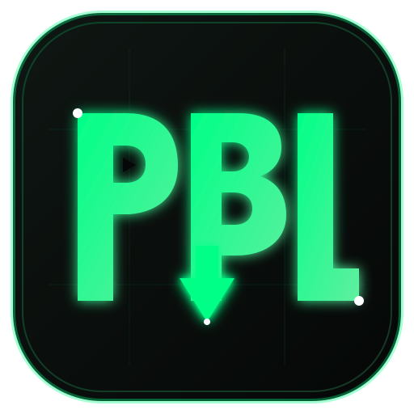

# DownBLink (DBL) - All-in-One Video Downloader & Player



**DownBLink** is a high-performance web service that allows downloading and streaming videos from over 1,000+ public platforms (YouTube, Instagram, TikTok, X/Twitter, Facebook, Reddit, DiskWala, TeraBox, Vimeo, Twitch, and more) simply by pasting a URL.

---

## 🌟 Key Features

- **Cyber Green & Black Theme**: High-contrast, dark aesthetic with emerald neon glows (`#00FF87`), obsidian panels, and crisp white typography.
- **Smart Platform Auto-Detection**: Real-time link parsing that detects 30+ major platforms with custom icons and branding tags.
- **In-Browser Video Player**: Preview and play videos directly on the website with HTTP 206 Partial Content byte-range support for seeking and scrubbing.
- **Multiple Qualities & Formats**:
  - Full HD (1080p, 1440p, 4K) auto-merged seamlessly with best audio tracks using FFmpeg stream copying (near-instant, lossless).
  - Format filters bar (`All`, `MP4 Only`, `WEBM Only`, `1080p+ HD`).
  - Standalone high-fidelity audio extraction (MP3 / M4A).
- **🖼️ 1-Click HD Thumbnail Downloader**: Download original maximum-resolution cover images directly to your device.
- **📱 Phone QR Code Transfer**: Scan a QR code with your phone camera or Google Lens to instantly download or stream the video to your mobile device over Wi-Fi.
- **DiskWala & TeraBox Native Cloud Resolvers**: Full integration for cloud storage links with zero corrupt downloads.
- **Automatic Cleanup**: Temporary merged files expire and auto-clean after 1 hour.

---

## 🛠️ Tech Stack

- **Backend**: Python 3.12, FastAPI, Uvicorn
- **Extraction Engine**: `yt-dlp` with Node.js runtime challenge solver
- **Video & Audio Remuxing**: Standalone FFmpeg stream muxer
- **Frontend**: Responsive Tailwind CSS, FontAwesome 6, Plyr HTML5 Player, QRCode.js
- **Proxy**: Asynchronous HTTP stream forwarder (`httpx`) supporting Byte-Range requests

---

## 🚀 Local Development

### 1. Install Dependencies
```bash
pip install -r requirements.txt
```

### 2. Configure Environment Variables
Copy `.env.example` to `.env`:
```bash
cp .env.example .env
```
Key variables:
- `PORT`: Web server port (Default: `8000`)
- `DISKWALA_COOKIE`: (Optional) Session cookie for private / restricted DiskWala video streaming
- `DISKWALA_API_KEY`: (Optional) DiskWala developer API key
- `DISKWALA_PROXY_URL`: DiskWala metadata extraction API endpoint
- `TERABOX_COOKIE`: (Optional) TeraBox session cookies for restricted links
- `TERABOX_API_URL`: (Optional) External TeraBox bypass API

### 3. Start the Server
```bash
python main.py
```
Or with Uvicorn:
```bash
uvicorn main:app --host 0.0.0.0 --port 8000 --reload
```

### 3. Open in Browser
Navigate to:
```
http://127.0.0.1:8000
```

---

## ☁️ Deploying to Render.com (Free & Recommended)

This repository includes a production-ready `Dockerfile` and `render.yaml` blueprint.

### Method 1: Deploy with Git (Recommended)
1. Push this project to your GitHub repository:
   ```bash
   git init
   git add .
   git commit -m "Initial commit of DownBLink"
   git remote add origin https://github.com/YOUR_USERNAME/YOUR_REPO.git
   git push -u origin main
   ```
2. Log in to [Render.com](https://render.com) and click **New +** -> **Web Service**.
3. Select **Build and deploy from a Git repository** and connect your GitHub repo.
4. Set the following settings:
   - **Name**: `downblink`
   - **Language / Runtime**: `Docker` (or select `render.yaml` Blueprint)
   - **Instance Type**: `Free`
5. Click **Create Web Service**. Render will automatically build the container with FFmpeg & Node.js, and give you your live URL (`https://downblink-xxxx.onrender.com`) in ~2 minutes!

---

## 📡 API Endpoints

| Method | Endpoint | Description |
| :--- | :--- | :--- |
| `GET` | `/` | Serves the DownBLink web interface |
| `GET` | `/api/detect?url=...` | Detects platform name and icon from URL regex |
| `POST` | `/api/extract` | Extracts full metadata, resolutions, and stream URLs |
| `GET` | `/api/stream?stream_url=...` | Streaming proxy with HTTP Byte-Range support for player |
| `GET` | `/api/download-stream?...` | Instant direct stream piping to browser download |
| `POST` | `/api/merge` | Triggers background video/audio merge job |
| `GET` | `/api/merge/status/{job_id}` | Polls progress of an active merge job |
| `GET` | `/api/download/{filename}` | Downloads the merged media file |
| `GET` | `/api/download-thumbnail?...` | Direct download for high-res cover thumbnail |
| `GET` | `/api/info/lan-ip` | Returns local LAN IP for phone QR code transfers |
| `GET` | `/api/qr?text=...` | Generates sharp QR Code PNG |
